<!-- ═══════════════════════════════════════════════════════════════
     GitHub Profile README · Adeel Rahman
     Repository: adeelrahman098-dotcom/adeelrahman098-dotcom
     ═══════════════════════════════════════════════════════════════ -->

<!-- ───────────────────────────── HEADER ───────────────────────────── -->

<!-- ───────────────────────────── TYPING SVG ───────────────────────────── -->

  
  

 

<!-- ────────────────────── SPLIT HERO: ABOUT + 3D PC ────────────────────── -->

<table>
  <tr>
    <td width="58%" valign="middle">
      <h2>👨‍💻 About Me</h2>
      

        I am a <b>Computer Science & Engineering</b> undergraduate majoring in <b>Data Science</b> at <b>East West University, Bangladesh</b>. My work focuses on designing reproducible, leakage-free machine learning workflows, empirical benchmarking, and practical AI applications.
      

      <ul>
        <li>🎓 <b>Degree:</b> B.Sc. in CSE (Major in Data Science)</li>
        <li>🔬 <b>Research Focus:</b> Leakage-Aware ML Pipelines, Ensemble Learning, Computer Vision & Lightweight AI</li>
        <li>💻 <b>Engineering:</b> Python ML Ecosystems, Deep Learning & Full-Stack Web Applications</li>
      </ul>
      

        <i>"Turning methodological gaps into trustworthy, reproducible machine learning systems."</i>
      

    </td>
    <td width="42%" align="center" valign="middle">
      <!-- 3D Isometric PC Setup Illustration -->
      
    </td>
  </tr>
</table>

 

<!-- ───────────────────────────── RESEARCH ───────────────────────────── -->

## 🔬 Research & Engineering Focus

| Domain | Core Methodology & Objective |
| :--- | :--- |
| **🛡️ Leakage-Free ML Evaluation** | Designing strict cross-validation, preprocessing, and feature engineering pipelines that prevent data leakage and yield reliable generalization estimates. |
| **🧠 Deep Learning & Vision** | Investigating convolutional and attention-based architectures for pattern recognition, gesture classification, and visual representation learning. |
| **⚡ Model Optimization & Ensembles** | Benchmarking gradient boosting, stacking ensembles, and evolutionary hyperparameter tuning for tabular and real-world datasets. |
| **🌐 Applied & Edge AI** | Building lightweight, low-latency AI models and full-stack software systems tailored for resource-constrained environments. |

 

<!-- ───────────────────────────── TECH STACK ───────────────────────────── -->

## 🛠️ Technical Arsenal

| Category | Technologies & Tools |
| :---: | :---: |
| **Languages** |  |
| **Data Science & ML** |    `NumPy` · `Pandas` · `XGBoost` · `HistGradientBoosting` · `DEAP` · `Dask` |
| **Web & Databases** |  |
| **DevTools & Environment** |  |

 

<!-- ───────────────────────────── ACHIEVEMENTS ───────────────────────────── -->

## 🏆 Academic Honors

| Honor / Award | Institution | Timeline |
| :--- | :--- | :--- |
| 🎖️ **100% Merit Scholarship** | East West University | Fall 2025 · Spring 2026 · Summer 2026 |
| 🥇 **Dean's Scholarship** | East West University | Fall 2024 · Spring 2025 · Summer 2025 |

 

<!-- ───────────────────────────── GITHUB STATS ───────────────────────────── -->

## 📊 GitHub Analytics

  
  

  

 

 

<!-- ───────────────────────────── COLLABORATION ───────────────────────────── -->

## 🤝 Collaboration

I'm open to collaborating on:

- 🤖 Applied AI and Machine Learning projects
- 🌍 Data Science projects addressing real-world problems
- 🔬 Research-oriented projects with reproducible experiments
- 💡 Open-source software that helps me grow as a developer and researcher

I'm especially drawn to collaborative work where **experimentation, clear documentation, and continuous improvement** matter.

 

<!-- ───────────────────────────── CONTACT ───────────────────────────── -->

## 📬 Connect With Me

  Feel free to reach out for discussions about AI, Machine Learning, Data Science, research, and collaboration.

  
  

<!-- ───────────────────────────── FOOTER ───────────────────────────── -->

 

*Learning continuously. Building thoughtfully. Researching responsibly.*

⭐ Thanks for visiting my profile!

